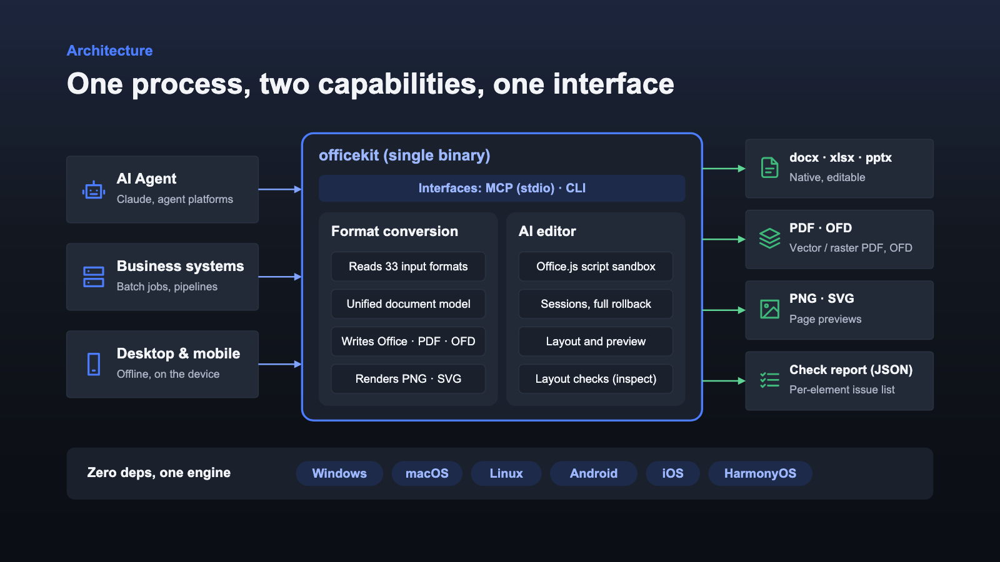
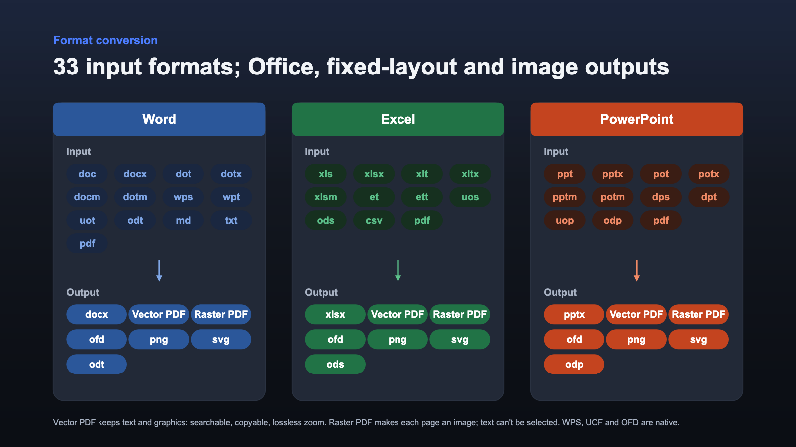
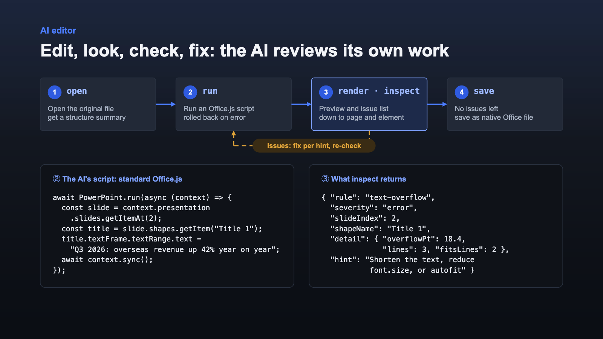
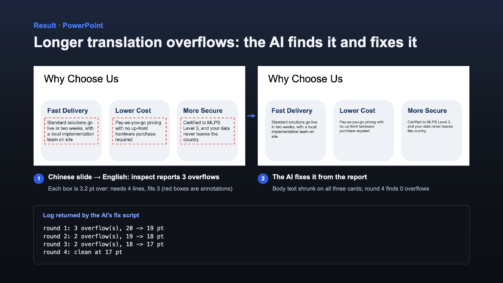
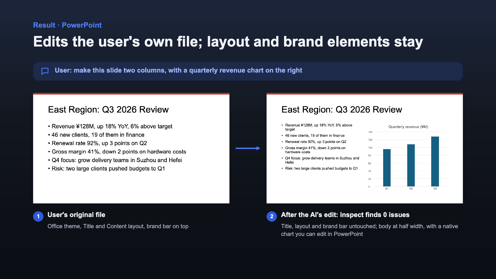
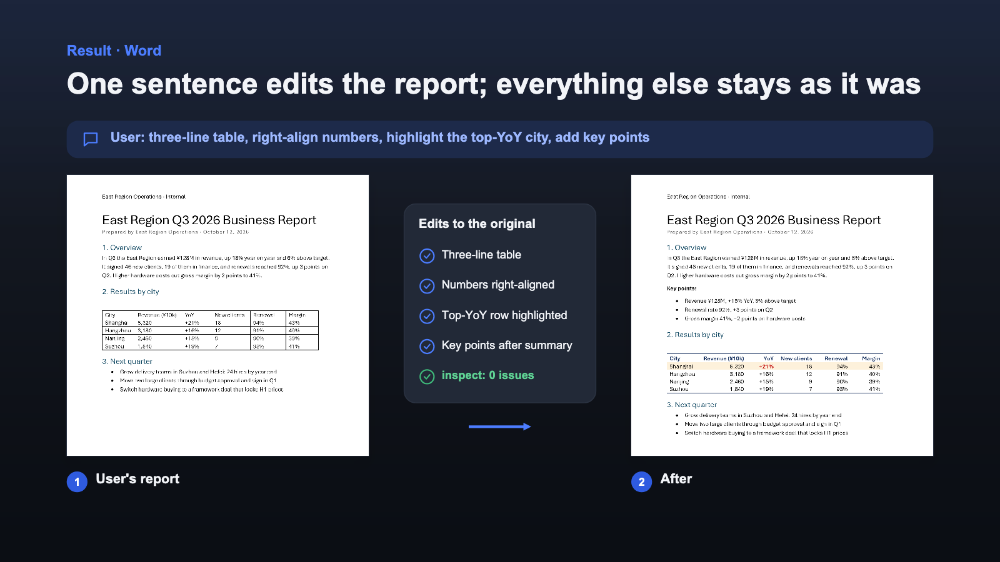
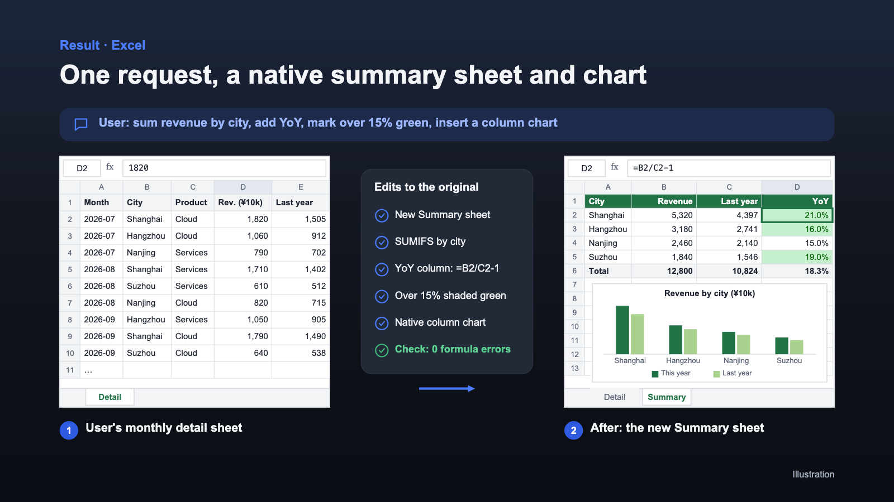

<div align="center">

<picture>
  <source media="(prefers-color-scheme: dark)" srcset="assets/logo-dark.svg">
  
</picture>

### Word, Excel and PowerPoint for code and AI.

One binary that converts, edits, renders and checks Office documents.<br>
No Office install. No UI. No network.

[Quick start](#quick-start) · [Format conversion](#format-conversion) · [AI editor](#ai-editor) · [Use with MCP](#use-with-mcp) · [简体中文](README.zh-CN.md)


</div>

https://github.com/user-attachments/assets/70b0fe61-b7dc-4e41-944a-68b4462df840

<p align="center"><sub>Convert legacy and WPS files in bulk, let AI edit a user's own deck in Office.js, and watch it check and fix its own layout.</sub></p>

## What it does

<table>
<tr>
<td width="50%" valign="top">

**Format conversion**

33 input formats, including Word, Excel, PowerPoint, WPS, UOF, ODF and PDF. Output is Office documents, vector PDF, raster PDF, OFD, PNG or SVG.

[Formats →](#format-conversion)

</td>
<td width="50%" valign="top">

**AI editor**

A headless editor built for AI. The AI writes Office.js, the API it already knows, and edits the original file in place. Every change returns a preview and an issue list, so it can check and fix its own work.

[How it works →](#ai-editor)

</td>
</tr>
</table>



## Quick start

**Convert a file**

```sh
officekit convert report.doc --to docx
officekit convert report.docx --to pdf                 # vector PDF
officekit convert report.docx --to pdf --raster        # raster PDF
officekit convert budget.et --to ofd
officekit convert deck.pptx --to png --pages 1-3 --out-dir thumbs/
```

**Edit, render and check**

```sh
officekit run edit.js --in deck.pptx --out out.pptx    # run an Office.js script
officekit render deck.pptx --slides 1-3 --width 1280 --out-dir png/
officekit inspect deck.pptx --json                     # print the issue list
```

**Connect it to your AI**

```sh
claude mcp add officekit -- officekit mcp --stdio
```

Other MCP clients: see [Use with MCP](#use-with-mcp).

## Why officekit

- **No dependencies.** One binary. No Office, LibreOffice, Java or Python, and no system components other than fonts.
- **Runs everywhere.** Windows, macOS, Linux, Android, iOS and HarmonyOS. The same engine runs on servers, desktops and phones, so documents can be processed offline on the user's device.
- **Native and editable.** Output uses Office's own formats: charts keep their data, tables take new rows, templates switch cleanly. The bar is that Office opens the file without a repair prompt.
- **Edits the original.** No round trip through an intermediate format. Untouched parts are kept as they are; changed parts are changed only where needed.
- **The AI checks its own work.** Every change returns a preview and a structured issue list (overflow, off-slide, overlap, contrast…), down to the page, the element and the fix.
- **Runs unattended.** Batch jobs run in the background. A failing script is rolled back as a whole, so no half-edited files are left behind. Scripts run in a sandbox with no file or network access.

## Format conversion



| | Input | Output |
| --- | --- | --- |
| **Word** | `doc` `docx` `dot` `dotx` `docm` `dotm` `wps` `wpt` `uot` `odt` `md` `txt` `pdf` | `docx` · vector PDF · raster PDF · `ofd` · `png` · `svg` · `odt` |
| **Excel** | `xls` `xlsx` `xlt` `xltx` `xlsm` `et` `ett` `uos` `ods` `csv` `pdf` | `xlsx` · vector PDF · raster PDF · `ofd` · `png` · `svg` · `ods` |
| **PowerPoint** | `ppt` `pptx` `pot` `potx` `pptm` `potm` `dps` `dpt` `uop` `odp` `pdf` | `pptx` · vector PDF · raster PDF · `ofd` · `png` · `svg` · `odp` |

- **Microsoft Office**: 97–2003 binary formats and OOXML, including templates and macro-enabled documents
- **WPS Office**: `wps` `wpt` `et` `ett` `dps` `dpt`
- **Chinese national standards**: UOF (`uot` `uos` `uop`) and OFD fixed-layout documents
- **Open formats**: ODF (`odt` `ods` `odp`)
- **Other**: PDF back to editable Office documents; Markdown, plain text, CSV

> **Vector or raster PDF?** Vector PDF keeps text and graphics, so it can be searched, copied and zoomed without loss. Raster PDF stores each page as an image: it looks exactly like the original, but the text can't be selected or extracted. Use it for distribution when you don't want the text copied.

## AI editor

### How it works



- **The AI writes standard Office.js**: `PowerPoint.run(async (context) => { ... })`, with `load` / `sync`, `*OrNullObject` and the official error codes, the same as in an Office add-in. Large models know this API well, so there is nothing new to learn.
- **It reads the formatting that actually applies**: font sizes and colors inherited from layouts, masters and themes are already resolved, so the AI doesn't have to dig through XML.
- **It can look and check after each change**: `render` produces previews, `inspect` produces the issue list.
- **Errors leave nothing behind**: if a script fails, all of its changes are rolled back.

### See it work

The PowerPoint and Word results below are real runs: the user's file and the AI's edits are Office.js scripts, and after the edit the engine renders the result and runs the checks.

#### A longer translation overflows: the AI finds it and fixes it

After a Chinese slide is replaced with English, inspect reports 3 text boxes overflowing by 3.2 pt each. The AI shrinks the body text on all three from the report, and the 4th check finds 0 overflows.



#### Edits the user's own file

"Make this slide two columns, with a quarterly revenue chart on the right": the title, layout and brand bar are kept, and the inserted chart is a native PowerPoint chart whose data can be edited in PowerPoint.



#### One sentence edits a Word report

Make the table a three-line table, right-align the numbers, highlight the city with the highest YoY growth and add key points after the overview; the header, title and other paragraphs stay untouched.



#### One sentence tidies an Excel report (illustration)

"Sum revenue by city, add a YoY column, mark anything over 15% green, and insert a column chart": a new summary sheet is added to the original workbook. The totals use SUMIFS, YoY is a formula, the green is conditional formatting and the chart is a native Excel chart; the detail sheet is untouched.



### Three editors

| Editor | Script entry | Coverage |
| --- | --- | --- |
| **Presentation** | `PowerPoint.run` | All 61 classes and 385 features of the PowerPoint JavaScript API (pinned version); adds charts, gradients, shadows, speaker notes, transitions and animations |
| **Document** | `Word.run` | All 656 members of Word JavaScript API 1.1–1.9; edits the original file, renders page previews, 8 layout and structure check rules |
| **Spreadsheet** | `Excel.run` | Works the same way: edits the original workbook, with native formulas, conditional formatting and charts, renders previews, checks for formula errors |

### When you need it

If the input files are a few templates of your own and the edits are a fixed set (fill data into fixed places, generate reports with a fixed structure), templates plus an open-source library will do the job at lower cost.

officekit's AI editor is for cases where **you don't know in advance**:

1. the input is whatever file the user brings, with any template;
2. the user asks for the change in plain language, and the AI decides how to make it;
3. nobody opens each result to check it, so a program has to judge whether the layout is OK;
4. you can't or don't want to run Office on the server;
5. you already have Office.js (Office add-in) code and want to run it in the background.

The more of these apply, the better officekit fits.

### Slides as code

Every deck the AI builds with officekit can keep the script that produced it. Run the same script twice and the files are byte-for-byte identical.

- **Cheap tweaks**: "change the main color" or "make every title one size larger" is one variable in the script; run it again and every slide follows.
- **Reviewable and reversible**: put the script in git and every change is visible.
- **Parameterized**: a script is a function; swap in new data or a client name to generate versions in bulk.
- **No lock-in**: scripts that don't use the extension API (`.ext`) are standard Office.js and also run in a real PowerPoint add-in.

Once someone edits the file by hand in Office, rerunning the full script overwrites those edits. From then on, write further changes as incremental scripts that act on the current file.

## Typical uses

- **AI edits documents users bring.** A user uploads a company template or an old file and asks to "make slide 3 two columns" or "switch the whole document to our company font". Neither the file nor the request is known in advance, so you can't write code against the template. officekit lets the AI edit the original file directly, keeps untouched formatting as it was, and checks the result before handing it back.
- **Translation and localization.** Translations into English or German usually run much longer than the source, and many text boxes overflow when the text goes back in. officekit lists every overflowing text box and by how much; the AI shrinks fonts, resizes boxes or tightens the translation, looping until nothing is left. The few cases it can't handle go to a layout person.
- **Office add-ins in the background.** An add-in written in Office.js only runs while a user has Office open. officekit runs the same code on the server unchanged, for background batch jobs or for testing add-in logic in CI.
- **Many AI sessions working on documents at once.** On AI agent platforms and AI office products, many users ask the AI to create and edit documents at the same time. There is no need to give each session a container with Python and LibreOffice: one officekit process serves many sessions, and each session's scripts run in their own sandbox with memory and time limits.
- **Batch format conversion.** Archive digitization, migration to domestic platforms, document archiving: convert WPS, UOF and legacy Office files to OOXML or OFD, or generate PDFs and thumbnails in bulk. The same binary runs on servers, desktops and mobile devices.

## Use with MCP

Claude Code:

```sh
claude mcp add officekit -- officekit mcp --stdio
```

Any other client that supports MCP:

```json
{
  "mcpServers": {
    "officekit": {
      "command": "officekit",
      "args": ["mcp", "--stdio"]
    }
  }
}
```

| Tool | What it does |
| --- | --- |
| `open` | Opens a file or creates a blank document; returns a session id and a summary of the document structure |
| `run` | Runs an Office.js script (JS or TS) in the session; returns the result, console output, errors and the scope of the change |
| `outline` | Lists the structure of each slide or section: shapes, positions, text summaries |
| `render` | Renders the given pages to PNG, optionally as a thumbnail grid |
| `inspect` | Returns the list of layout issues |
| `save` | Saves to a file |
| `api_reference` | Returns the API notes written for the AI |
| `close` | Closes the session |

## Check rules

Every issue comes with the page number and the paragraph or table index, so the AI can go straight to it. Thresholds are adjustable and rules can be turned off one by one.

<details>
<summary><b>PowerPoint</b>: 8 rules</summary>

| Rule | What it checks | Default severity |
| --- | --- | --- |
| `text-overflow` | Text overflows its text box; reports the overflow and line count | error |
| `off-slide` | A shape lies fully or partly outside the slide | warning |
| `overlap` | Two blocks of text overlap, or text is covered by another shape | warning |
| `empty-placeholder` | A placeholder was left empty | warning |
| `font-fallback` | A font is missing and was replaced | warning |
| `low-contrast` | Text contrast below WCAG 4.5:1 (3:1 for large text) | warning |
| `tiny-text` | Effective font size below the threshold (default 10 pt) | info |
| `misalignment` | Shapes that should align are off by less than 1 pt | info |

</details>

<details>
<summary><b>Word</b>: 8 rules</summary>

| Rule | What it checks | Default severity |
| --- | --- | --- |
| `table-overflow` | A table runs past the text area or the page | warning / error |
| `image-overflow` | An image runs past the text area or the page | warning / error |
| `heading-at-page-end` | A heading sits at the bottom of a page while its text starts on the next | warning |
| `blank-page` | A page with no content | warning |
| `font-fallback` | A font is missing and was replaced | warning |
| `heading-skip` | Heading levels skip (for example, level 2 followed by level 4) | warning |
| `widow-orphan` | A paragraph split across pages leaves a single line on one page | info |
| `empty-paragraphs` | Several empty paragraphs in a row | info |

</details>

## Platforms and deployment

| | |
| --- | --- |
| **Deliverable** | One binary, no runtime dependencies |
| **Platforms** | Windows, macOS, Linux, Android, iOS, HarmonyOS |
| **Interfaces** | Command line, MCP (stdio) |
| **Deployment** | Servers, intranets, desktop apps, mobile apps; can run fully offline |

## Benchmarks

| | Result |
| --- | --- |
| **Consistency with PowerPoint** | Checked against real PowerPoint on Windows: generated files must open in PowerPoint without a repair prompt; 86 reference scripts (13 of them Microsoft's official samples) run on both sides and the results are compared item by item |
| **Usability for AI** | Claude, using only officekit, completed 8 typical tasks (deck from an outline, editing an existing deck, charts from data, fixing layout from the issue list, 4:3 to 16:9, inserting images, bulk formatting, long Chinese text layout): all 8 done, US$0.81 in total |
| **Speed** | A 100-slide deck with 2,000 elements: adding 1,000 elements in one go 0.23 s, saving 0.085 s, rendering a slide 0.22 s, checking all 100 slides 1.8 s (single machine) |
