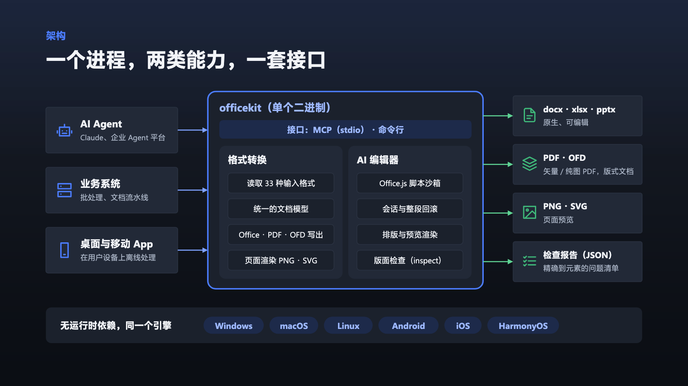
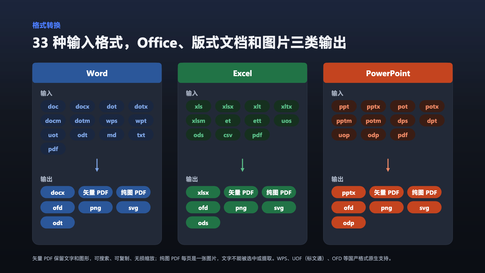
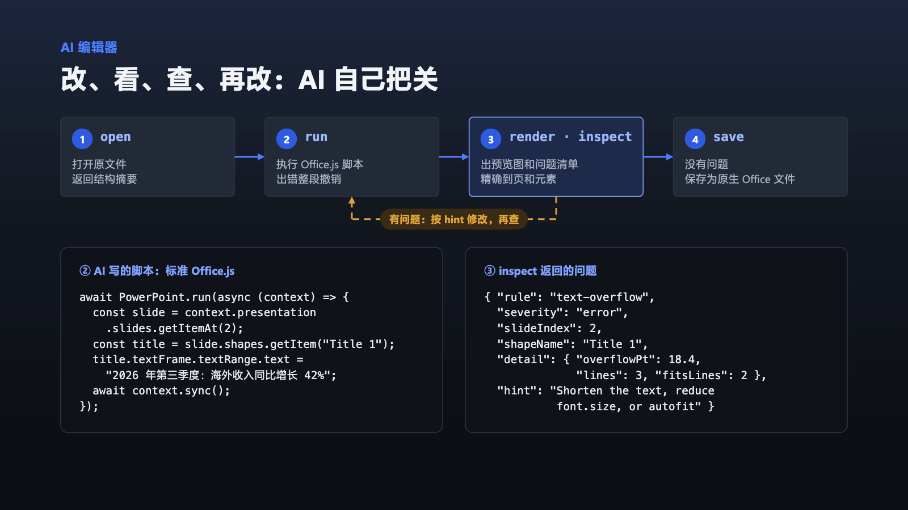
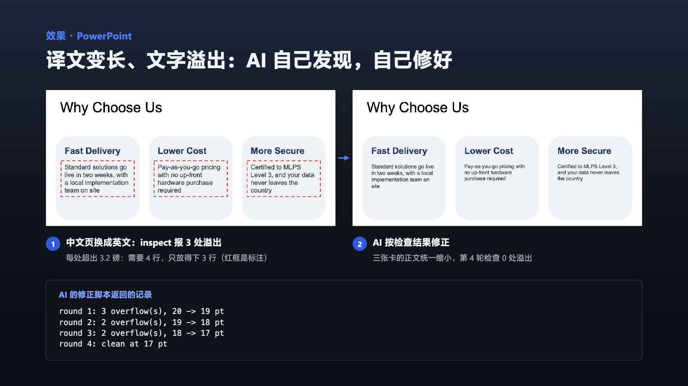
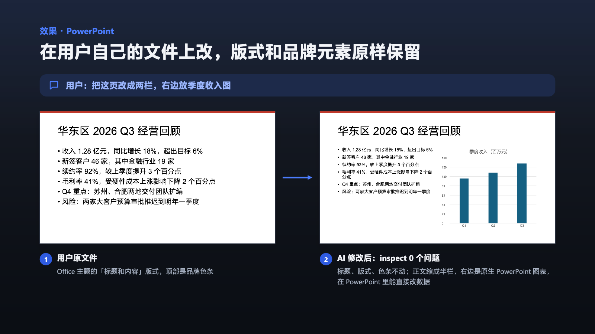
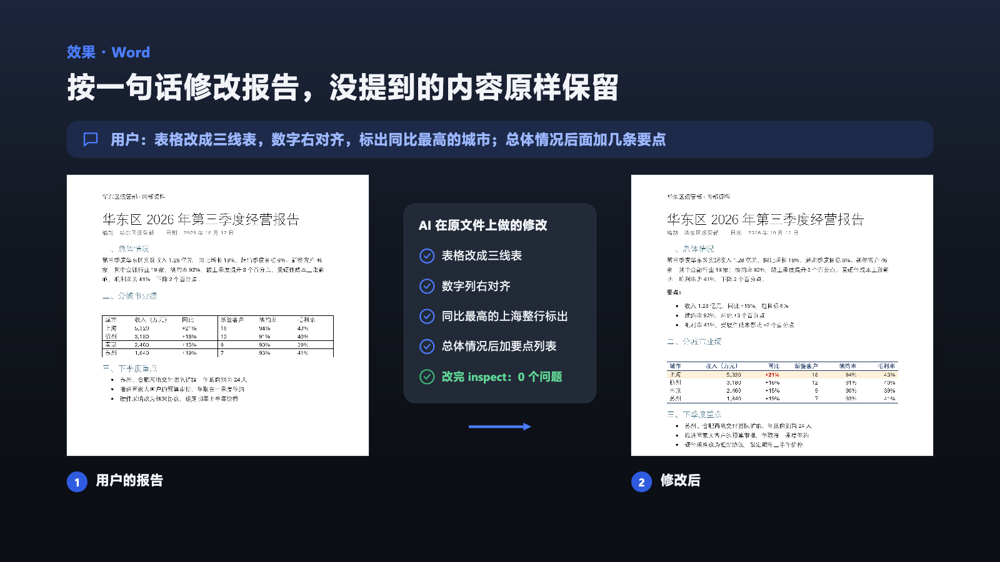

<div align="center">

<picture>
  <source media="(prefers-color-scheme: dark)" srcset="assets/logo-dark.svg">
  
</picture>

### 让程序和 AI 直接读写 Word、Excel、PowerPoint

一个二进制文件，完成 Office 文档的转换、编辑、渲染和检查。<br>
不装 Office，不要界面，不连网络。

[快速开始](#快速开始) · [格式转换](#格式转换) · [AI 编辑器](#ai-编辑器) · [接入 MCP](#接入-mcp) · [English](README.md)


</div>

https://github.com/user-attachments/assets/87f5aab3-aec8-4b0b-9b48-75ee88efe7e4

<p align="center"><sub>批量转换 WPS 和老版本文件；AI 用 Office.js 修改用户自己的 PPT，并自己检查、修好版面。</sub></p>

## 能做什么

<table>
<tr>
<td width="50%" valign="top">

**格式转换**

Word、Excel、PPT、WPS、UOF、ODF、PDF 等 33 种输入格式，输出 Office 文档、矢量 PDF、纯图 PDF、OFD、PNG、SVG。

[支持的格式 →](#格式转换)

</td>
<td width="50%" valign="top">

**AI 编辑器**

为 AI 而生的无界面编辑器。AI 用它最熟悉的 Office.js 写脚本，直接在原文件上修改；每次修改后拿到预览图和问题清单，自己检查、自己修。

[工作方式 →](#ai-编辑器)

</td>
</tr>
</table>



## 快速开始

**转换文件**

```sh
officekit convert report.doc --to docx
officekit convert report.docx --to pdf                 # 矢量 PDF
officekit convert report.docx --to pdf --raster        # 纯图 PDF
officekit convert budget.et --to ofd
officekit convert deck.pptx --to png --pages 1-3 --out-dir thumbs/
```

**修改、渲染、检查**

```sh
officekit run edit.js --in deck.pptx --out out.pptx    # 运行一段 Office.js 脚本
officekit render deck.pptx --slides 1-3 --width 1280 --out-dir png/
officekit inspect deck.pptx --json                     # 输出问题清单
```

**接入你的 AI**

```sh
claude mcp add officekit -- officekit mcp --stdio
```

其他 MCP 客户端见[接入 MCP](#接入-mcp)。

## 为什么用 officekit

- **无依赖。** 只有一个二进制文件。不需要 Office、LibreOffice、Java、Python，也不需要字体以外的任何系统组件。
- **哪里都能跑。** Windows、macOS、Linux、Android、iOS、HarmonyOS，同一个引擎跑在服务器、桌面和手机上，用户设备上也能离线处理文档。
- **原生、可编辑。** 输出的是 Office 自己的格式：图表能改数据，表格能加行，换模板正常。以「Office 打开不弹修复提示」为硬门槛。
- **在原文件上改。** 不做中间格式转换。没改的部分原样保留，改的部分只动需要动的地方。
- **AI 能自查。** 每次修改后返回预览图和结构化的问题清单（溢出、越界、遮挡、对比度……），精确到页、到元素、到改法。
- **可以无人值守。** 后台批量运行；脚本出错整段撤销，不会留下改了一半的文件；脚本在沙箱里运行，不能访问文件和网络。

## 格式转换



| | 输入 | 输出 |
| --- | --- | --- |
| **Word** | `doc` `docx` `dot` `dotx` `docm` `dotm` `wps` `wpt` `uot` `odt` `md` `txt` `pdf` | `docx` · 矢量 PDF · 纯图 PDF · `ofd` · `png` · `svg` · `odt` |
| **Excel** | `xls` `xlsx` `xlt` `xltx` `xlsm` `et` `ett` `uos` `ods` `csv` `pdf` | `xlsx` · 矢量 PDF · 纯图 PDF · `ofd` · `png` · `svg` · `ods` |
| **PowerPoint** | `ppt` `pptx` `pot` `potx` `pptm` `potm` `dps` `dpt` `uop` `odp` `pdf` | `pptx` · 矢量 PDF · 纯图 PDF · `ofd` · `png` · `svg` · `odp` |

- **Microsoft Office**：97–2003 二进制格式、OOXML（含模板、启用宏的文档）
- **WPS Office**：`wps` `wpt` `et` `ett` `dps` `dpt`
- **国家标准**：UOF 标文通（`uot` `uos` `uop`）、OFD 版式文档
- **开放格式**：ODF（`odt` `ods` `odp`）
- **其他**：PDF 转回可编辑的 Office 文档；Markdown、纯文本、CSV

> **矢量 PDF 还是纯图 PDF？** 矢量 PDF 保留文字和图形，可以搜索、复制、无损缩放；纯图 PDF 每页是一张图片，看起来和原文件一致，但文字不能被选中或提取，适合对外分发、防止复制的场景。

## AI 编辑器

### 工作方式



- **AI 写的是标准 Office.js**：`PowerPoint.run(async (context) => { ... })`，`load` / `sync`、`*OrNullObject`、官方错误码都和 Office 加载项里一致。大模型对这套接口很熟，不用学新 API。
- **读到的是实际生效的格式**：从版式、母版、主题继承下来的字号、颜色都已解析，AI 不用自己翻 XML。
- **改完能看、能查**：`render` 出预览图，`inspect` 出问题清单。
- **出错不留残局**：一段脚本失败，这段脚本做的修改整体撤销。

### 效果

PowerPoint 和 Word 的三张图都是真实运行结果：用户文件和 AI 的修改都是 Office.js 脚本，改完由引擎渲染成图、跑一遍检查。

#### 译文变长、文字溢出：AI 自己发现，自己修好

中文页换成英文后，inspect 报出 3 个文本框各溢出 3.2 磅；AI 按检查结果统一缩小正文字号，第 4 轮检查 0 处溢出。



#### 在用户自己的文件上改

「把这页改成两栏，右边放季度收入图」：标题、版式、品牌色条原样保留，右边插入的是原生 PowerPoint 图表，在 PowerPoint 里能直接改数据。



#### Word 报告按一句话修改

表格改成三线表、数字右对齐、标出同比最高的城市、在「总体情况」后加要点列表；页眉、标题、其余段落都不动。



#### Excel 报表按一句话整理（示意图）

「按城市汇总收入，加一列同比，超过 15% 的标绿，再插一张柱形图」：在原工作簿里新建汇总表，汇总用 SUMIFS、同比是公式、标绿用条件格式、图表是原生 Excel 图表，明细表不动。


### 三个编辑器

| 编辑器 | 脚本入口 | 覆盖范围 |
| --- | --- | --- |
| **幻灯片** | `PowerPoint.run` | 支持 PowerPoint JavaScript API（锁定版本）的全部 61 个类、385 个功能点；另外补充了图表、渐变、阴影、演讲者备注、切换效果和动画 |
| **文字** | `Word.run` | Word JavaScript API 1.1–1.9 的全部 656 个成员已实现；在原文件上改，渲染页面预览，8 条排版和结构检查规则 |
| **表格** | `Excel.run` | 同样的工作方式：在原工作簿上改，公式、条件格式、图表都是原生的，渲染预览，检查公式错误 |

### 什么时候需要它

如果输入的文件是你自己的几套模板、要做的修改是固定的几种（往固定位置填数据、生成固定结构的报告），用模板加开源库定制开发就能做好，成本更低。

officekit 的 AI 编辑器为**事先不确定**的情况设计：

1. 输入是用户自带的任意文件，模板五花八门；
2. 修改要求由用户用自然语言提出，由 AI 现场决定怎么改；
3. 没有人逐份打开检查结果，要靠程序判断版面有没有问题；
4. 不能或不想在服务器上运行 Office；
5. 已经有基于 Office.js（Office 加载项）写的代码，想搬到后台运行。

满足得越多，officekit 越合适。

### PPT 即代码

AI 用 officekit 做的每一份 PPT，都可以留下一份生成它的脚本。同一段脚本运行两次，生成的文件逐字节相同。

- **微调便宜**：「换主色」「所有标题加大一号」只改脚本里一个变量，重跑即可，每一页都一致生效。
- **能审阅、能回退**：脚本放进 git，每次改了什么一目了然。
- **能参数化**：一份脚本就是一个函数，换一批数据、换个客户名，就能批量生成不同版本。
- **不被锁定**：不使用扩展接口（`.ext`）的脚本是标准 Office.js，在真实 PowerPoint 的加载项里也能运行。

人在 Office 里手动改过文件之后，再重跑完整脚本会覆盖这些修改。这时把后续修改写成增量脚本作用在当前文件上。

## 典型场景

- **AI 修改用户自带的文档。** 用户上传公司模板或旧文件，说「把第 3 页改成两栏」「全篇换成公司字体」。文件和要求都是事先不知道的，没法针对模板写程序。officekit 让 AI 直接在原文件上改，没碰的格式原样保留，改完自查再交付。
- **文档翻译和本地化。** 中文翻成英文、德文后，译文通常长得多，填回去大量文本框溢出。officekit 列出每个溢出的文本框和溢出量，AI 据此缩小字号、调整文本框或精简译文，循环到没有问题；剩下少数处理不了的再交给排版人员。
- **Office 加载项搬到后台。** 用 Office.js 写的加载项只能在用户打开 Office 时运行。officekit 让同一段代码不用修改直接在服务端运行，用于后台批量处理，或者在持续集成里自动测试加载项逻辑。
- **大量 AI 会话同时处理文档。** AI Agent 平台、AI 办公产品里，同时有大量用户让 AI 生成和修改文档。不必给每个会话开一个装着 Python 和 LibreOffice 的容器：officekit 一个进程承载多个会话，每个会话的脚本在独立沙箱里运行，有内存和时间上限。
- **批量格式转换。** 档案数字化、信创迁移、文档归档：把 WPS、UOF、老版 Office 文件统一转成 OOXML 或 OFD，或者批量生成 PDF 和缩略图。服务端、桌面端、移动端用同一个二进制。

## 接入 MCP

Claude Code：

```sh
claude mcp add officekit -- officekit mcp --stdio
```

其他支持 MCP 的客户端：

```json
{
  "mcpServers": {
    "officekit": {
      "command": "officekit",
      "args": ["mcp", "--stdio"]
    }
  }
}
```

| 工具 | 作用 |
| --- | --- |
| `open` | 打开文件或新建空白文档，返回会话 id 和文档结构摘要 |
| `run` | 在会话里运行一段 Office.js 脚本（JS 或 TS），返回结果、console 输出、错误和本次改动的范围 |
| `outline` | 列出每页 / 每节的结构：形状、位置、文字摘要 |
| `render` | 渲染指定页为 PNG，可拼成缩略图网格 |
| `inspect` | 返回版面问题清单 |
| `save` | 保存为文件 |
| `api_reference` | 返回给 AI 看的接口说明 |
| `close` | 关闭会话 |

## 检查规则

每条问题都带页码和段落或表格的序号，AI 可以直接定位修改。阈值可以调整，规则可以单独关闭。

<details>
<summary><b>PowerPoint</b>：8 条规则</summary>

| 规则 | 检查内容 | 默认级别 |
| --- | --- | --- |
| `text-overflow` | 文字超出文本框，给出溢出量和行数 | error |
| `off-slide` | 形状全部或部分超出页面 | warning |
| `overlap` | 两段文字重叠，或文字被其他形状挡住 | warning |
| `empty-placeholder` | 留着没填的占位符 | warning |
| `font-fallback` | 字体缺失，被替换成了其他字体 | warning |
| `low-contrast` | 文字与背景对比度低于 WCAG 4.5:1（大字 3:1） | warning |
| `tiny-text` | 实际字号小于阈值（默认 10 pt） | info |
| `misalignment` | 本应对齐的形状差了 1 pt 以内 | info |

</details>

<details>
<summary><b>Word</b>：8 条规则</summary>

| 规则 | 检查内容 | 默认级别 |
| --- | --- | --- |
| `table-overflow` | 表格超出版心或页面 | warning / error |
| `image-overflow` | 图片超出版心或页面 | warning / error |
| `heading-at-page-end` | 标题落在页底，正文到了下一页 | warning |
| `blank-page` | 出现没有内容的空白页 | warning |
| `font-fallback` | 字体缺失，被替换成了其他字体 | warning |
| `heading-skip` | 标题跳级（例如二级标题后直接是四级） | warning |
| `widow-orphan` | 段落跨页时一页上只剩一行 | info |
| `empty-paragraphs` | 连续多个空段落 | info |

</details>

## 平台与部署

| | |
| --- | --- |
| **交付物** | 一个二进制文件，无运行时依赖 |
| **平台** | Windows、macOS、Linux、Android、iOS、HarmonyOS |
| **接入方式** | 命令行、MCP（stdio） |
| **部署** | 服务器、企业内网、桌面应用、移动 App；可以完全离线运行 |

## 实测数据

| | 结果 |
| --- | --- |
| **与 PowerPoint 的一致性** | 以 Windows 上的真实 PowerPoint 为对照：生成的文件必须能被 PowerPoint 直接打开且不提示修复；86 个对照脚本（其中 13 个是微软官方示例）在两边分别运行，逐项比对结果 |
| **AI 好不好用** | 让 Claude 只通过 officekit 完成 8 项典型任务（按大纲做汇报、改现成的 PPT、用数据做图表、按问题清单修版面、4:3 改 16:9、插图片、批量统一格式、中文长文排版），8 项全部完成，总花费 0.81 美元 |
| **速度** | 100 页、2000 个元素的演示文稿：一次添加 1000 个元素 0.23 秒，保存 0.085 秒，渲染一页 0.22 秒，检查全部 100 页 1.8 秒（单机测试） |
